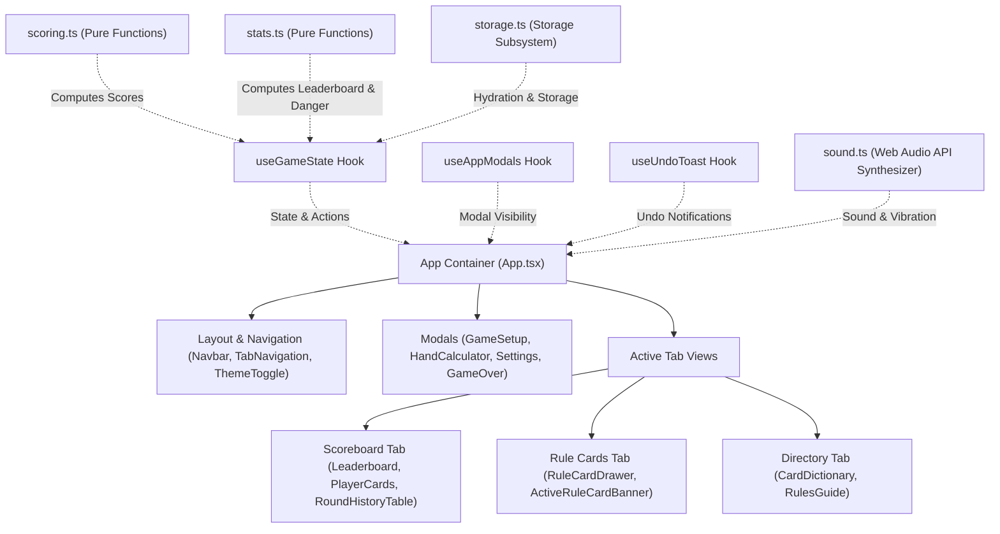
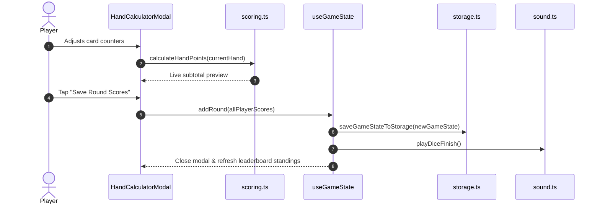

# System Architecture & Technical Design

This document details the software architecture, core design principles, modular state management engine, pure domain calculation utilities, procedural audio system, automated test suite, and project structure for **Frantic: Pandora's Box – Digital Companion App**.

---

## Table of Contents

- [Architectural Overview](#architectural-overview)
- [Technology Stack](#technology-stack)
- [Project Directory Structure](#project-directory-structure)
- [Core Architecture Subsystems](#core-architecture-subsystems)
  - [1. Game State Management & Custom Hooks (`useGameState.ts`, `useAppModals.ts`, `useUndoToast.tsx`)](#1-game-state-management--custom-hooks)
  - [2. Domain Calculation & Rules Engine (`scoring.ts`, `stats.ts`)](#2-domain-calculation--rules-engine)
  - [3. Persistence & Storage Subsystem (`storage.ts`)](#3-persistence--storage-subsystem)
  - [4. Procedural Audio & Haptic Feedback (`sound.ts`)](#4-procedural-audio--haptic-feedback)
  - [5. Theming & Design System (`colors.ts` & `useTheme.ts`)](#5-theming--design-system)
  - [6. Internationalization & Search Engine (`i18n.ts` & `translations.ts`)](#6-internationalization--search-engine)
  - [7. Automated Testing Architecture (Vitest & React Testing Library)](#7-automated-testing-architecture)
- [Data Flow & Lifecycle](#data-flow--lifecycle)
- [Related Documentation](#related-documentation)

---

## Architectural Overview

The application is built as a responsive, offline-first client-side Single Page Application (SPA). Because it is used in real-time during physical card game sessions, the architecture emphasizes:

1. **Deterministic Domain Logic**: Pure functions in `src/utils/` calculate hand scores, statistical standings, and presets deterministically without side effects.
2. **Modular Root Architecture**: Components are strictly decomposed by responsibility into dedicated subdirectories (`layout/`, `setup/`, `scoring/`, `scoreboard/`, `rules/`, `rulecards/`).
3. **Zero-Latency Interactions & Robust Persistence**: Immediate optimistic updates with automatic synchronization to browser `localStorage` and schema validation on restore/import.
4. **Zero Asset Overhead**: Audio effects and icons are synthesized in code via Web Audio API or bundled via SVG primitives.
5. **Strict Type Safety & Automated Verification**: Comprehensive TypeScript contracts paired with unit, hook, and integration tests covering all critical paths.



---

## Technology Stack

| Layer          | Technology                                                                                                                                                                             | Version   | Purpose                                                              |
| :------------- | :------------------------------------------------------------------------------------------------------------------------------------------------------------------------------------- | :-------- | :------------------------------------------------------------------- |
| **Framework**  | [React](https://react.dev/)                                                                                                                                                            | `^18.3.1` | Component-based UI with declarative state rendering                  |
| **Language**   | [TypeScript](https://www.typescriptlang.org/)                                                                                                                                          | `^5.7.3`  | Static typing, interface contracts, and compile-time verification    |
| **Build Tool** | [Vite](https://vitejs.dev/)                                                                                                                                                            | `^6.1.0`  | Ultra-fast development server with ES modules and production bundler |
| **Testing**    | [Vitest](https://vitest.dev/), [React Testing Library](https://testing-library.com/), [jest-dom](https://github.com/testing-library/jest-dom), [jsdom](https://github.com/jsdom/jsdom) | `^5.0.4`  | Automated unit, hook, and UI component testing suite                 |
| **Styling**    | [Tailwind CSS](https://tailwindcss.com/)                                                                                                                                               | `^4.3.3`  | Utility-first responsive CSS styling with custom theme tokens        |
| **Icons**      | [Lucide React](https://lucide.dev/)                                                                                                                                                    | `^1.16.0` | Lightweight, scalable vector iconography                             |
| **Animations** | [canvas-confetti](https://github.com/catdad/canvas-confetti)                                                                                                                           | `^1.9.4`  | High-performance particle celebration effects on match completion    |
| **Feedback**   | [react-hot-toast](https://react-hot-toast.com/)                                                                                                                                        | `^2.6.1`  | Contextual toast notifications for alerts, copy, and undo events     |
| **Audio**      | [Web Audio API](https://developer.mozilla.org/en-US/docs/Web/API/Web_Audio_API)                                                                                                        | Native    | Procedural sound generation without binary asset overhead            |

---

## Project Directory Structure

```text
pandoras-box-app/
├── docs/                                  # Modular technical and game documentation
│   ├── ARCHITECTURE.md                    # System architecture, state engine & design (this file)
│   ├── CONTRIBUTING.md                    # Developer guidelines and extension workflows
│   ├── DEPLOYMENT.md                      # Production build and hosting guide
│   ├── FEATURES.md                        # Detailed app feature breakdown
│   ├── GAME_RULES.md                      # Complete Frantic and Pandora's Box rules reference
│   └── SETUP.md                           # Installation, local development, and scripts
│
├── public/                                # Static public assets (favicons, manifest)
│
├── rules/                                 # Official Rulefactory PDF rulebooks (EN, DE, FR, IT)
│   ├── Pandoras_Box_Gesamtregelwerk_EN_web.pdf
│   ├── Pandoras_Box_Gesamtregelwerk_DE_web.pdf
│   ├── Pandoras_Box_Gesamtregelwerk_FR.pdf
│   ├── Pandoras_Box_Gesamtregelwerk_IT_web.pdf
│   ├── Uebersichtskarten_EN_web.pdf
│   ├── Uebersichtskarten_DE_web.pdf
│   ├── Uebersichtskarten_FR_web.pdf
│   └── Uebersichtskarten_IT_web.pdf
│
├── src/                                   # Application source code
│   ├── App.tsx                            # Root application component orchestrating view & modals
│   ├── main.tsx                           # React DOM entry point
│   ├── index.css                          # Global styling directives and theme setup
│   │
│   ├── components/                        # React UI components
│   │   ├── common/                        # Shared reusable widgets
│   │   │   ├── AppLogo.tsx                # Brand logo component
│   │   │   └── HelpTooltip.tsx            # Contextual tooltip popover
│   │   │
│   │   ├── events/                        # Event-specific tools
│   │   │   └── D20DiceRoller.tsx          # Interactive 20-sided dice roller
│   │   │
│   │   ├── layout/                        # Shell, headers, and modal wrappers
│   │   │   ├── settings/                  # Decomposed settings modal sections
│   │   │   │   ├── SettingsBackupSection.tsx  # JSON import, export, and reset controls
│   │   │   │   ├── SettingsGeneralSection.tsx # Audio toggles and theme selector
│   │   │   │   └── SettingsLegalSection.tsx   # Legal disclaimers and copyrights
│   │   │   ├── Footer.tsx                 # Application footer
│   │   │   ├── LanguageSelector.tsx       # Multilingual selector modal
│   │   │   ├── Navbar.tsx                 # Top navigation header bar
│   │   │   ├── SettingsModal.tsx          # Settings dialog shell
│   │   │   ├── TabNavigation.tsx          # Bottom/top tab navigation bar
│   │   │   └── ThemeToggle.tsx            # Theme mode toggle
│   │   │
│   │   ├── rulecards/                     # Pandora's Box expansion cards
│   │   │   ├── ActiveRuleCardBanner.tsx   # Pinned active rule card banner
│   │   │   └── RuleCardDrawer.tsx         # Randomizer drawer & card browser
│   │   │
│   │   ├── rules/                         # Encyclopedia & guide views
│   │   │   ├── CardDictionary.tsx         # Searchable card & event database
│   │   │   ├── EventCardsSection.tsx      # Event cards directory list
│   │   │   ├── OfficialPdfBanner.tsx      # In-browser PDF rulebook launcher
│   │   │   ├── PowerCardsSection.tsx      # Supercharge power cards directory
│   │   │   ├── RuleCardsSection.tsx       # Rule cards directory list
│   │   │   ├── RulesGuide.tsx             # Official rules guide container
│   │   │   ├── RulesSummary.tsx           # Rules overview component
│   │   │   ├── SearchBar.tsx              # Filter search input with clear trigger
│   │   │   └── SpecialCardsSection.tsx    # Special cards directory list
│   │   │
│   │   ├── scoreboard/                    # Scoreboard views & components
│   │   │   ├── __tests__/                 # Scoreboard component tests
│   │   │   │   ├── Leaderboard.test.tsx       # Leaderboard integration tests
│   │   │   │   └── RoundHistoryTable.test.tsx # Round history table tests
│   │   │   ├── GameOverModal.tsx          # Winner celebration dialog
│   │   │   ├── Leaderboard.tsx            # Standings & round history view
│   │   │   ├── PlayerCard.tsx             # Player progress card
│   │   │   ├── RoundHistoryTable.tsx      # Historical rounds list & actions
│   │   │   └── StatsOverviewCards.tsx     # Leader & danger zone summary metrics
│   │   │
│   │   ├── scoring/                       # Round scoring calculators
│   │   │   ├── __tests__/                 # Scoring calculator tests
│   │   │   │   ├── HandCalculatorModal.test.tsx # Scoring modal interaction tests
│   │   │   │   └── RoundScoringModal.test.tsx   # Scoring modal alias tests
│   │   │   ├── HandCalculatorModal.tsx    # Interactive hand point calculator
│   │   │   ├── NumberGrid.tsx             # 1–10 number cards stepper grid
│   │   │   ├── RoundScoringModal.tsx      # Calculator component re-export alias
│   │   │   ├── ScoringModifiers.tsx       # Doomsday, bomb, and custom modifiers
│   │   │   ├── ScoringPlayerPicker.tsx    # Player selector for scoring
│   │   │   └── SpecialCounters.tsx        # Special card count steppers
│   │   │
│   │   └── setup/                         # Match configuration
│   │       ├── __tests__/                 # Setup component tests
│   │       │   ├── GameSetupModal.test.tsx      # Match setup dialog tests
│   │       │   └── ScoreLimitSelector.test.tsx  # Score limit selector tests
│   │       ├── GameSetupModal.tsx         # Match configuration dialog
│   │       ├── PlayerConfig.tsx           # Player roster and pawn color picker
│   │       ├── ScoreLimitPresets.tsx      # Official score presets
│   │       └── ScoreLimitSelector.tsx     # Custom and preset limit selector
│   │
│   ├── data/                              # Localized static datasets & constants
│   │   ├── cardsData.ts                   # Special card definitions and tips
│   │   ├── eventsData.ts                  # Event card definitions and ratings
│   │   ├── faqData.ts                     # Common rule rulings and FAQ
│   │   ├── powerCardsData.ts              # Supercharge power cards specifications
│   │   ├── ruleCardsData.ts               # 15 Pandora's Box rule card definitions
│   │   ├── rulesConstants.ts              # Official rule guide sections & rules
│   │   └── translations.ts                # Multilingual dictionaries (EN, DE, IT, FR)
│   │
│   ├── hooks/                             # Custom React hooks
│   │   ├── __tests__/                     # Hooks unit tests
│   │   │   ├── useAppModals.test.ts       # Modal state management tests
│   │   │   ├── useGameState.test.ts       # Central game engine hook tests
│   │   │   └── useTheme.test.ts           # Theme toggle hook tests
│   │   ├── useAppModals.ts                # Application modal visibility controller
│   │   ├── useGameState.ts                # Central game engine state hook
│   │   ├── useTheme.ts                    # Dark/Light/System theme provider hook
│   │   └── useUndoToast.tsx               # Contextual undo action toast hook
│   │
│   ├── test/                              # Testing setup & environment
│   │   └── setup.ts                       # Vitest setup file (jest-dom & browser mocks)
│   │
│   ├── types/                             # TypeScript model definitions
│   │   ├── game.ts                        # Match state, round, player, & score models
│   │   └── rules.ts                       # Card, event, and rule card interfaces
│   │
│   └── utils/                             # Pure calculation & system utilities
│       ├── __tests__/                     # Pure utility unit tests
│       │   ├── colors.test.ts             # Pawn theme color tests
│       │   ├── i18n.test.ts               # Localization & search filter tests
│       │   ├── scoring.test.ts            # Hand scoring calculation engine tests
│       │   ├── stats.test.ts              # Leaderboard analytics & ranking tests
│       │   └── storage.test.ts            # LocalStorage persistence tests
│       ├── colors.ts                      # 10 player pawn theme color palettes
│       ├── i18n.ts                        # Text localization & search matching helpers
│       ├── scoring.ts                     # Pure scoring calculation engine & presets
│       ├── sound.ts                       # Web Audio procedural sound synthesizer
│       ├── stats.ts                       # Pure leaderboard metrics & danger calculator
│       └── storage.ts                     # LocalStorage persistence & migration engine
│
├── .husky/                                # Git hook scripts
│   └── pre-commit                         # Pre-commit hook running lint, type-check, and test
├── eslint.config.js                       # ESLint configuration
├── netlify.toml                           # Netlify hosting build & redirect configuration
├── package.json                           # Dependencies, testing, and build scripts
├── tailwind.config.js                     # Tailwind styling tokens and plugins
├── tsconfig.json                          # TypeScript compiler configuration with test types
└── vite.config.ts                         # Vite & Vitest configuration with plugins
```

---

## Core Architecture Subsystems

### 1. Game State Management & Custom Hooks

The application orchestrates state through specialized custom hooks:

#### `useGameState.ts`

The single source of truth for match progress:

- **Round Lifecycle**: `addRound()`, `editRound()`, `deleteRound()`, `undoLastRound()`.
- **Match Management**: `startNewGame()`, `updateGameSetup()`, `resetCurrentGame()`, `continueGame()`, `concludeGame()`, `resetAllData()`.
- **Backup Serialization**: `exportGameState()`, `importGameState()`.
- **Automatic Persistence**: Automatically syncs state to `storage.ts` whenever mutations occur.

#### `useAppModals.ts`

Decoupled dialog visibility manager controlling the Setup modal, Score/Hand Calculator modal, Settings modal (with initial tab selection), and Game Over dismissal states.

#### `useUndoToast.tsx`

Provides immediate feedback toasts with integrated action buttons (e.g. "Undo Round") using `react-hot-toast`.

---

### 2. Domain Calculation & Rules Engine

Domain rules are completely extracted into standalone pure functions in `src/utils/`:

#### `src/utils/scoring.ts`

Contains official penalty card values and the pure calculation function:

```typescript
export const CARD_POINTS = {
  SPECIAL: 7,
  CURSE: 13,
  THE_END: 17,
  FUCK_YOU: 42,
  MIMICRY: 7,
  DOOMSDAY: 50,
  TIME_BOMB_BONUS: 10,
  TIME_BOMB_PENALTY: 10,
} as const;

export function calculateHandPoints(
  hand: Omit<HandScore, 'totalPoints'> | HandScore
): number;
```

Ensures zero discrepancy between the calculator UI preview, persisted history logs, and round editing.

#### `src/utils/stats.ts`

Computes derived leaderboard standings:

- **Score Accumulation**: Calculates total penalty points and round win totals.
- **Rank Sorting**: Sorts players ascending (lowest score is rank 1 and leader).
- **Danger Zone Detection**: Flags players when total score reaches $\ge 80\%$ of target score (`DANGER_THRESHOLD_RATIO = 0.8`).
- **Elimination Status**: Flags players when total score crosses or equals the target score.

---

### 3. Persistence & Storage Subsystem (`storage.ts`)

Encapsulates all browser `localStorage` operations under typed storage keys:

- `STORAGE_KEYS.GAME_STATE` (`frantic_game_state_v2`)
- `STORAGE_KEYS.LANGUAGE` (`frantic_lang_v2`)
- `STORAGE_KEYS.THEME` (`frantic_theme_mode`)

Includes automatic schema validation and fallback recovery:

- Ensures minimum target score of 50 points on hydration.
- Gracefully catches corrupted JSON records and returns clean initial state.
- Validates supported language and theme codes.

---

### 4. Procedural Audio & Haptic Feedback (`sound.ts`)

Synthesizes responsive sound effects on demand via the browser's native **Web Audio API** without external audio file dependencies:

- **Dice Roll / Shuffle (`playDiceRoll`)**: Randomized multi-frequency oscillator bursts with mobile vibration feedback (`navigator.vibrate([30, 25, 20...])`).
- **Tactile Click (`playClick`)**: High-frequency sine impulse for interactive button taps.
- **Victory Chime (`playWinner`)**: Multi-harmonic arpeggiated fanfare for match-ending celebrations.
- **Warning (`playWarning`)**: Sawtooth alert tone for validation warnings (e.g. score limit $< 50$).

---

### 5. Theming & Design System

- **Player Color System** ([`src/utils/colors.ts`](../src/utils/colors.ts)): Defines 10 distinct player pawns (Red, Blue, Green, Yellow, Purple, Orange, White, Black, Cyan, Pink) with full Tailwind badges, rings, and glowing border themes.
- **Theme Provider** ([`src/hooks/useTheme.ts`](../src/hooks/useTheme.ts)): Supports `light`, `dark`, and `system` modes, tracking OS `prefers-color-scheme` dynamically.

---

### 6. Internationalization & Search Engine

- **Translations Engine** ([`src/utils/i18n.ts`](../src/utils/i18n.ts) & [`src/data/translations.ts`](../src/data/translations.ts)):
  - 4 languages supported: **English (`en`)**, **German (`de`)**, **Italian (`it`)**, and **French (`fr`)**.
  - `getLocalizedText(map, lang, fallback)` provides safe string retrieval.
  - `matchesSearchQuery(fields, query)` provides unified multi-field search filtering for the card and rules encyclopedia.

---

### 7. Automated Testing Architecture

Testing is built with **Vitest**, **React Testing Library**, **@testing-library/jest-dom**, and **jsdom**:

- **Setup File** ([`src/test/setup.ts`](../src/test/setup.ts)): Configures custom DOM matchers, mocks `window.matchMedia` and `canvas-confetti`, and automatically clears DOM and `localStorage` between tests.
- **Unit Tests** (`src/utils/__tests__/`): Tests pure domain calculations (`scoring.test.ts`, `stats.test.ts`, `storage.test.ts`, `i18n.test.ts`, `colors.test.ts`).
- **Hook Tests** (`src/hooks/__tests__/`): Tests React hook lifecycle and state mutations (`useGameState.test.ts`, `useTheme.test.ts`, `useAppModals.test.ts`).
- **Component Tests** (`src/components/**/__tests__/`): Tests complete user workflows via `@testing-library/user-event` for setup modals, limit selectors, hand calculators, leaderboards, and round history tables.

---

## Data Flow & Lifecycle



---

## Related Documentation

- **[Installation & Setup](SETUP.md)**: Steps to run, test, and build the application locally.
- **[Application Features](FEATURES.md)**: Detailed feature breakdown.
- **[Game Rules Reference](GAME_RULES.md)**: Official rules and scoring specifications.
- **[Contributing Guide](CONTRIBUTING.md)**: How to extend the card database, write tests, or modify logic.
- **[Deployment Guide](DEPLOYMENT.md)**: Publishing to Netlify or static hosts.
