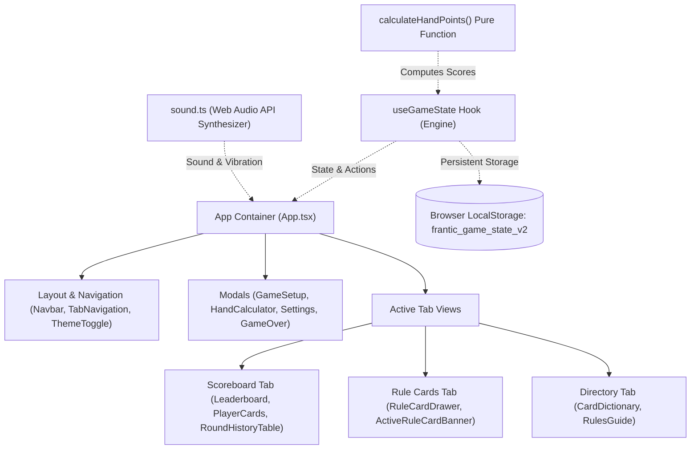
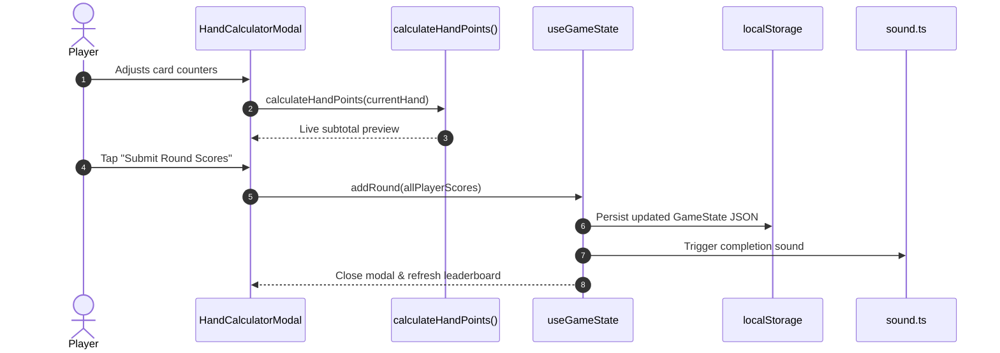

# System Architecture & Technical Design

This document details the software architecture, core design principles, state management engine, procedural audio system, and project structure for **Frantic: Pandora's Box – Digital Companion App**.

---

## Table of Contents

- [Architectural Overview](#architectural-overview)
- [Technology Stack](#technology-stack)
- [Project Directory Structure](#project-directory-structure)
- [Core Architecture Subsystems](#core-architecture-subsystems)
  - [1. Game State Management (`useGameState.ts`)](#1-game-state-management-usegamestatets)
  - [2. Hand Calculation Engine](#2-hand-calculation-engine)
  - [3. Procedural Audio & Haptic Feedback (`sound.ts`)](#3-procedural-audio--haptic-feedback-soundts)
  - [4. Theming & Design System (`colors.ts` & `useTheme.ts`)](#4-theming--design-system-colorsts--usethemets)
  - [5. Internationalization & Localization (`translations.ts`)](#5-internationalization--localization-translationsts)
- [Data Flow & Lifecycle](#data-flow--lifecycle)
- [Related Documentation](#related-documentation)

---

## Architectural Overview

The application is built as a responsive, offline-first client-side Single Page Application (SPA). Because it is used in real-time during physical card game sessions, the architecture emphasizes:

1. **Deterministic State**: Game state transitions are immutable and driven by pure functions.
2. **Zero-Latency Interactions**: No roundtrip network requests during gameplay; local persistence ensures session durability even across browser reloads or device crashes.
3. **Zero Asset Overhead**: Audio effects and icons are synthesized in code or bundled via SVGs, eliminating external asset loading dependencies.
4. **Strict Type Safety**: Comprehensive TypeScript models ensure consistent scoring rules, multilingual dictionary alignment, and component properties.



---

## Technology Stack

| Layer          | Technology                                                                      | Version   | Purpose                                                              |
| :------------- | :------------------------------------------------------------------------------ | :-------- | :------------------------------------------------------------------- |
| **Framework**  | [React](https://react.dev/)                                                     | `^18.3.1` | Component-based UI with declarative state rendering                  |
| **Language**   | [TypeScript](https://www.typescriptlang.org/)                                   | `^5.7.3`  | Static typing, interface contracts, and compile-time verification    |
| **Build Tool** | [Vite](https://vitejs.dev/)                                                     | `^6.1.0`  | Ultra-fast development server with ES modules and production bundler |
| **Styling**    | [Tailwind CSS](https://tailwindcss.com/)                                        | `^4.3.3`  | Utility-first responsive CSS styling with custom theme tokens        |
| **Icons**      | [Lucide React](https://lucide.dev/)                                             | `^1.16.0` | Lightweight, scalable vector iconography                             |
| **Animations** | [canvas-confetti](https://github.com/catdad/canvas-confetti)                    | `^1.9.4`  | High-performance particle celebration effects on match completion    |
| **Feedback**   | [react-hot-toast](https://react-hot-toast.com/)                                 | `^2.6.1`  | Contextual toast notifications for alerts, copy, and undo events     |
| **Audio**      | [Web Audio API](https://developer.mozilla.org/en-US/docs/Web/API/Web_Audio_API) | Native    | Procedural sound generation without binary asset overhead            |

---

## Project Directory Structure

```text
pandoras-box-app/
├── docs/                         # Modular technical and game documentation
│   ├── ARCHITECTURE.md           # System architecture, state engine & design (this file)
│   ├── CONTRIBUTING.md           # Developer guidelines and extension workflows
│   ├── DEPLOYMENT.md             # Production build and hosting guide
│   ├── FEATURES.md               # Detailed app feature breakdown
│   ├── GAME_RULES.md             # Complete Frantic and Pandora's Box rules reference
│   └── SETUP.md                  # Installation, local development, and scripts
│
├── public/                       # Static public assets (favicons, manifest)
│
├── rules/                        # Official Rulefactory PDF rulebooks (EN, DE, FR, IT)
│   ├── Pandoras_Box_Gesamtregelwerk_EN_web.pdf
│   ├── Pandoras_Box_Gesamtregelwerk_DE_web.pdf
│   ├── Pandoras_Box_Gesamtregelwerk_FR.pdf
│   ├── Pandoras_Box_Gesamtregelwerk_IT_web.pdf
│   ├── Uebersichtskarten_EN_web.pdf
│   ├── Uebersichtskarten_DE_web.pdf
│   ├── Uebersichtskarten_FR_web.pdf
│   └── Uebersichtskarten_IT_web.pdf
│
├── src/                          # Application source code
│   ├── App.tsx                   # Main root component, router & modal manager
│   ├── main.tsx                  # React DOM entry point
│   ├── index.css                 # Global CSS and Tailwind directives
│   │
│   ├── components/               # React UI components
│   │   ├── common/               # Reusable primitive UI widgets
│   │   │   └── HelpTooltip.tsx   # Contextual helper tooltip popover
│   │   ├── events/               # Event-specific components
│   │   │   └── D20DiceRoller.tsx # Dice utility interface
│   │   ├── layout/               # Navigation, headers, and shell
│   │   │   ├── LanguageSelector.tsx # 4-language toggle modal/dropdown
│   │   │   ├── Navbar.tsx        # Top status bar with sound, rules, and settings
│   │   │   ├── SettingsModal.tsx # Application settings dialog
│   │   │   ├── TabNavigation.tsx # Responsive bottom/top navigation bar
│   │   │   └── ThemeToggle.tsx   # Light/Dark/System theme switch
│   │   ├── rulecards/            # Pandora's Box expansion cards
│   │   │   ├── ActiveRuleCardBanner.tsx # Pinned active round rule card banner
│   │   │   └── RuleCardDrawer.tsx       # Shuffling drawer & card directory
│   │   ├── rules/                # Encyclopedia and reference components
│   │   │   ├── CardDictionary.tsx# Searchable card/event database
│   │   │   ├── RulesGuide.tsx    # Official rules guide & setup instructions
│   │   │   ├── RulesSummary.tsx  # Re-export alias for rule dictionary
│   │   │   └── SearchBar.tsx     # Filter input with clear action
│   │   ├── scoreboard/           # Primary match scoreboard
│   │   │   ├── GameOverModal.tsx # Match winner modal with confetti
│   │   │   ├── Leaderboard.tsx   # Ranking cards and round table
│   │   │   ├── PlayerCard.tsx    # Player score card with progress bar
│   │   │   └── RoundHistoryTable.tsx # Detailed round log with edit/undo
│   │   ├── scoring/              # Round scoring calculators
│   │   │   ├── HandCalculatorModal.tsx # Interactive point calculator modal
│   │   │   ├── NumberGrid.tsx    # 1–10 number card counter grid
│   │   │   ├── RoundScoringModal.tsx   # Backward-compatible calculator alias
│   │   │   └── SpecialCounters.tsx     # Stepper inputs for special cards
│   │   └── setup/                # Match configuration
│   │       ├── GameSetupModal.tsx      # Match setup & player roster dialog
│   │       ├── PlayerConfig.tsx        # Color picker and player inputs
│   │       ├── ScoreLimitPresets.tsx   # Official group-size score thresholds
│   │       └── ScoreLimitSelector.tsx  # Custom score target slider
│   │
│   ├── data/                     # Localized game datasets
│   │   ├── cardsData.ts          # Special card specifications and tips
│   │   ├── eventsData.ts         # Event card definitions and ratings
│   │   ├── faqData.ts            # Common rule rulings and FAQ
│   │   ├── powerCardsData.ts     # Supercharge power cards specifications
│   │   ├── ruleCardsData.ts      # 15 Pandora's Box rule card definitions
│   │   └── translations.ts       # Multilingual dictionaries (EN, DE, IT, FR)
│   │
│   ├── hooks/                    # Custom React hooks
│   │   ├── useGameState.ts       # Central game engine hook & score calculator
│   │   └── useTheme.ts           # Dark/Light/System theme provider hook
│   │
│   ├── types/                    # TypeScript interfaces
│   │   ├── game.ts               # Core game state, round, and score models
│   │   └── rules.ts              # Card, Event, and RuleCard data interfaces
│   │
│   └── utils/                    # Utility helpers
│       ├── colors.ts             # 10 player pawn theme color palettes
│       └── sound.ts              # Web Audio procedural sound synthesizer
│
├── eslint.config.js              # ESLint configuration
├── netlify.toml                  # Netlify hosting build & redirect configuration
├── package.json                  # Dependencies and build scripts
├── tailwind.config.js            # Tailwind styling tokens and plugins
├── tsconfig.json                 # TypeScript compiler setup
└── vite.config.ts                # Vite build and plugin setup
```

---

## Core Architecture Subsystems

### 1. Game State Management (`useGameState.ts`)

The central game engine is encapsulated in [`src/hooks/useGameState.ts`](../src/hooks/useGameState.ts). It serves as the single source of truth for the match:

```typescript
export interface GameState {
  players: Player[];
  config: GameConfig;
  rounds: RoundEntry[];
  activeRuleCard: RuleCard | null;
  isGameOver: boolean;
  gameId: string;
}
```

#### Key Capabilities

- **Automatic Persistence**: Every state transition serializes to browser `localStorage` under `frantic_game_state_v2`.
- **Derived Analytics**: Player standings are dynamically calculated using `useMemo`:
  - Cumulative score summing across rounds.
  - Sorting from lowest penalty score (rank 1) to highest.
  - Danger Zone detection ($\ge 80\%$ of target score).
  - Round win counters and elimination distance.
- **Full History Editing & Undo**:
  - `addRound(scores)`: Appends a completed round.
  - `editRound(roundIndex, scores)`: Updates historical round records with automatic score recalculation.
  - `deleteRound(roundIndex)` / `undoLastRound()`: Reverts the match state safely.
- **Match Portability**: Supports complete JSON export and schema-validated JSON import for cross-device migration.

---

### 2. Hand Calculation Engine

Penalty points are calculated deterministically via the pure function `calculateHandPoints` in [`src/hooks/useGameState.ts`](../src/hooks/useGameState.ts):

```typescript
export function calculateHandPoints(
  hand: Omit<HandScore, 'totalPoints'> | HandScore
): number {
  if (hand.isDoomsday) return 50;
  if (hand.isWinner) {
    let pts = hand.timeBombModifier === 'winner_bonus' ? -10 : 0;
    return Math.max(0, pts + (hand.customModifier || 0));
  }

  let total = 0;
  // Sum face values of number cards (1 to 10)
  if (hand.numberCards) {
    Object.entries(hand.numberCards).forEach(([numStr, count]) => {
      total += parseInt(numStr, 10) * count;
    });
  }
  // Add special card points
  total += (hand.specialCardsCount || 0) * 7;
  total += (hand.curseCount || 0) * 13;
  total += (hand.theEndCount || 0) * 17;
  total += (hand.fuckYouCount || 0) * 42;
  total += (hand.mimicryCount || 0) * 7;

  // Apply Time Bomb modifier
  if (hand.timeBombModifier === 'expired_double') total *= 2;
  else if (hand.timeBombModifier === 'loser_penalty') total += 10;
  else if (hand.timeBombModifier === 'winner_bonus') total -= 10;

  total += hand.customModifier || 0;
  return Math.max(0, total);
}
```

This pure function ensures zero discrepancy between user input, modal totals, and persisted round logs.

---

### 3. Procedural Audio & Haptic Feedback (`sound.ts`)

Instead of requiring external audio MP3/WAV files that increase bundle size and cause loading delays, [`src/utils/sound.ts`](../src/utils/sound.ts) synthesizes sounds on demand via the browser's native **Web Audio API**:

- **Dice Roll / Shuffle (`playDiceRoll`)**: Generates rapid, randomized frequency bursts to simulate tumbling dice during Rule Card drawing, accompanied by mobile vibration patterns (`navigator.vibrate([20, 30, 20])`).
- **Tactile Click (`playClick`)**: A subtle high-frequency impulse providing responsive feedback for button taps.
- **Victory Chime (`playWinner` / `playDiceFinish`)**: Multi-oscillator arpeggiated major chord chords for celebration events.
- **User Preferences**: All audio and haptic outputs respect user mute toggles stored in local preferences.

---

### 4. Theming & Design System (`colors.ts` & `useTheme.ts`)

- **Player Color System** ([`src/utils/colors.ts`](../src/utils/colors.ts)): Defines 10 distinct player pawns (Red, Blue, Green, Yellow, Purple, Orange, White, Black, Cyan, Pink). Each color provides hex values, avatar backgrounds, and glowing border rings customized for both light and dark backgrounds.
- **Theme Provider** ([`src/hooks/useTheme.ts`](../src/hooks/useTheme.ts)): Supports three modes:
  - `light`: Crisp, high-contrast daytime palette.
  - `dark`: Deep midnight slate palette optimized for low-light game sessions.
  - `system`: Tracks the OS `prefers-color-scheme` media query dynamically.

---

### 5. Internationalization & Localization (`translations.ts`)

Localization is maintained in [`src/data/translations.ts`](../src/data/translations.ts) and card data modules:

- Languages supported: **English (`en`)**, **German (`de`)**, **Italian (`it`)**, and **French (`fr`)**.
- Fully typed schema (`TranslationStrings`) guarantees that every UI string key is implemented across all supported languages.
- Card descriptions, flavor text, tips, and rulings are translated natively inside `cardsData.ts`, `eventsData.ts`, and `ruleCardsData.ts`.

---

## Data Flow & Lifecycle



---

## Related Documentation

- **[Installation & Setup](SETUP.md)**: Steps to run and build the application locally.
- **[Application Features](FEATURES.md)**: Detailed feature breakdown.
- **[Game Rules Reference](GAME_RULES.md)**: Official rules and scoring specifications.
- **[Contributing Guide](CONTRIBUTING.md)**: How to extend the card database or modify logic.
- **[Deployment Guide](DEPLOYMENT.md)**: Publishing to Netlify or static hosts.
