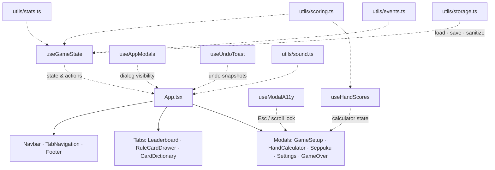
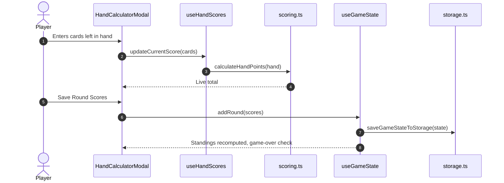

# Architecture

How the app is structured and why.

---

## Table of Contents

- [Overview](#overview)
- [Technology Stack](#technology-stack)
- [Project Structure](#project-structure)
- [State Engine (`useGameState`)](#state-engine-usegamestate)
- [Domain Logic (`scoring.ts`, `stats.ts`, `events.ts`)](#domain-logic-scoringts-statsts-eventsts)
- [Persistence & Validation (`storage.ts`)](#persistence--validation-storagets)
- [Offline Support (PWA)](#offline-support-pwa)
- [UI Layer](#ui-layer)
- [Internationalisation](#internationalisation)
- [Audio & Haptics](#audio--haptics)
- [Testing](#testing)
- [Data Flow](#data-flow)

---

## Overview

The app is a client-only, offline-first single-page application. There is no backend: all state lives in the browser and is persisted to `localStorage`.

Design principles:

1. **Pure domain logic.** Scoring and standings are pure functions in `src/utils/`, independent of React and fully unit-tested.
2. **One source of truth.** `useGameState` owns the match state; components receive data and callbacks through props.
3. **Defensive persistence.** Anything read from outside the running app — saved state, imported files, undo snapshots — goes through `sanitizeGameState()` before use.
4. **Rules fidelity.** Rule values (points, limits, timings, end-of-game condition) are taken from the official rulebook and locked in by tests.
5. **No asset overhead.** Sounds are synthesised; icons are SVG components.



---

## Technology Stack

| Layer    | Technology                                             | Purpose                                         |
| :------- | :----------------------------------------------------- | :---------------------------------------------- |
| UI       | React 18, TypeScript (strict)                          | Components and type-safe domain model           |
| Styling  | Tailwind CSS 4 (`@tailwindcss/vite`, CSS-first config) | Utility classes, dark mode via the `dark` class |
| Build    | Vite 6                                                 | Dev server and production bundle                |
| Offline  | `vite-plugin-pwa` (Workbox `generateSW`)               | Service worker precaching the app and the PDFs  |
| Feedback | `react-hot-toast`, `canvas-confetti`, Web Audio API    | Toasts with undo, celebration, procedural sound |
| Icons    | `lucide-react`                                         | SVG icons                                       |
| Testing  | Vitest, React Testing Library, jest-dom, jsdom         | Unit, hook and component tests                  |
| Quality  | ESLint, Prettier, Husky, lint-staged, GitHub Actions   | Static checks locally and in CI                 |

Exact versions are pinned in [`package.json`](../package.json) and `package-lock.json`.

---

## Project Structure

```text
pandoras-box-app/
├── .github/
│   ├── CODEOWNERS                  # Default reviewers
│   └── workflows/ci.yml            # CI: type-check, lint, format, test, build
├── .husky/pre-commit               # lint-staged + type-check + tests
├── docs/                           # Project documentation
├── public/
│   ├── rules/                      # Official Rulefactory PDFs (EN, DE, FR, IT)
│   ├── site.webmanifest            # PWA manifest
│   └── …                           # Icons, Open Graph image
│                                   # (robots.txt and sitemap.xml are generated by vite.config.ts)
├── src/
│   ├── App.tsx                     # Root: wires state, tabs and modals
│   ├── main.tsx                    # React entry point
│   ├── index.css                   # Tailwind entry, custom utilities, reduced-motion
│   ├── components/
│   │   ├── card-dictionary/        # Rules tab: CardDictionary, CategoryFilter,
│   │   │                           # RulesGuide (+ GuideSection), OfficialPdfBanner,
│   │   │                           # Special/Event/Power/RuleCards sections
│   │   ├── common/                 # AppLogo, HelpTooltip, RichText
│   │   ├── events/                 # SeppukuModal, SeppukuPlayerChoice
│   │   ├── layout/                 # Navbar, TabNavigation, Footer, ThemeToggle,
│   │   │   │                       # LanguageSelector, SettingsModal, AppToaster
│   │   │   └── settings/           # General, Backup and Legal settings sections
│   │   ├── rule-cards/             # RuleCardDrawer, RuleCardSpotlight, RuleCardTile,
│   │   │                           # ActiveRuleCardBanner
│   │   ├── scoreboard/             # Leaderboard, PlayerCard, StatsOverviewCards,
│   │   │                           # RoundHistoryTable, RoundHistoryEntry,
│   │   │                           # HistoryScoreCell, GameOverModal
│   │   ├── scoring/                # HandCalculatorModal, ActivePlayerBanner,
│   │   │                           # WinnerToggle, NumberGrid, SpecialCounters,
│   │   │                           # ScoringModifiers, ScoringPlayerPicker
│   │   └── setup/                  # GameSetupModal, PlayerConfig,
│   │                               # ScoreLimitSelector, RoundLimitSelector
│   ├── data/
│   │   ├── cards/                  # Special cards: coloured, open-wish, unique
│   │   ├── events/                 # Event cards per expansion
│   │   ├── translations/           # UI strings: types.ts + en, de, it, fr
│   │   ├── powerCards.ts           # Supercharge power cards (1ST / 2ND)
│   │   ├── ruleCards.ts            # Pandora's Box rule cards
│   │   ├── rulebookLinks.ts        # Rulebook PDF URLs per language
│   │   └── rulesGuideContent.ts    # Localized text of the rules summary
│   ├── hooks/                      # useGameState, useHandScores, useAppModals,
│   │                               # useUndoToast, useTheme, useModalA11y
│   ├── test/setup.ts               # jest-dom matchers and browser mocks
│   ├── types/                      # game.ts (match model), rules.ts (card model)
│   └── utils/                      # scoring, stats, events, storage, cardSearch,
│                                   # i18n, colors, sound
├── index.html                      # Meta tags, JSON-LD, no-flash theme script
├── netlify.toml                    # Netlify build, headers and SPA fallback
├── vite.config.ts                  # Vite, PWA, base path, site-URL injection,
│                                   # robots.txt / sitemap.xml, Vitest
└── tsconfig.json · eslint.config.js · .prettierrc
```

Tests live next to the code in `__tests__/` folders.

---

## State Engine (`useGameState`)

[`src/hooks/useGameState.ts`](../src/hooks/useGameState.ts) owns the `GameState`:

```ts
interface GameState {
  players: Player[];
  config: { targetScore: number; presetName: …; roundLimit?: number | null };
  rounds: RoundEntry[];          // rounds and event entries, in order
  activeRuleCardIds?: string[];
  isGameStarted: boolean;
  isGameOver: boolean;
  winnerId: string | null;
  isContinued?: boolean;
}
```

- **Rounds and events share one list.** A `RoundEntry` with `isEvent: true` (Identity Theft, Seppuku, late joiner) stores the point deltas it applied and does **not** count as a round. Its `roundNumber` is the number of completed rounds before it; deleting a round renumbers rounds and re-anchors events.
- **Actions**: `addRound`, `editRound`, `deleteRound`, `undoLastRound`, `applyIdentityTheft`, `applySeppuku`, `setActiveRuleCardIds`, `startNewGame`, `updateGameSetup` (handles late joiners), `resetCurrentGame`, `continueGame`, `concludeGame`, `resetAllData`, `exportGameState`, `importGameState`, `restoreGameState`.
- **Game-over lifecycle**: an effect applies `getGameOverUpdate()` (a pure function in `stats.ts`). The match ends when a player **exceeds** the limit (`isOverScoreLimit`) or the optional round limit is reached; the lowest score is the winner. `continueGame` suppresses the automatic end until `concludeGame`.
- **Events** are built by pure functions in `utils/events.ts`; the hook only appends or replaces entries. `applyIdentityTheft()` returns the swapped pair (or `null`), so the UI can name both players in the toast.
- **Auto-save**: every state change is written to storage.
- **Undo**: `App.tsx` wraps each action in `withUndo()`, which hands a deep copy of the previous state to `useUndoToast`; _Undo_ restores it through `restoreGameState`, which ignores snapshots that fail `sanitizeGameState()`.

[`useHandScores`](../src/hooks/useHandScores.ts) holds the end-of-round calculator state: one hand per player, the selected player, and the table-wide Doomsday and Time Bomb modes. Several players can be marked as winners.

[`useAppModals`](../src/hooks/useAppModals.ts) holds dialog visibility; [`useModalA11y`](../src/hooks/useModalA11y.ts) gives every dialog Esc-to-close and background scroll lock.

---

## Domain Logic (`scoring.ts`, `stats.ts`, `events.ts`)

**[`src/utils/scoring.ts`](../src/utils/scoring.ts)** — official values and the hand calculator:

```ts
export const CARD_POINTS = {
  SPECIAL: 7,
  CURSE: 13,
  THE_END: 17,
  FUCK_YOU: 42,
  MIMICRY: 7,
  DOOMSDAY: 50,
  TIME_BOMB_BONUS: 10,
  TIME_BOMB_PENALTY: 10,
} as const;

export const SCORE_PRESETS = {
  few: { short: 137, medium: 154, long: 179 }, // 2–4 players
  many: { short: 113, medium: 137, long: 154 }, // 5–8 players
} as const;

export const SEPPUKU_POINTS = {
  risk_number: -21,
  risk_special: 42,
  no_risk: 21,
};
export const UNIQUE_CARD_LIMIT = 1; // Curse, The End, Fuck You, Mimicry

export function calculateHandPoints(hand): number;
```

Order of evaluation: Doomsday (50) or winner (0, −10 if Time Bomb defused) or card points (special cards ×2 when the _Double Special_ rule card is active, then Time Bomb ×2 if exploded or +10 if defused) → free adjustment, which is **always** applied (also on Doomsday, e.g. for Lucky Bastard). Results may be negative.

**[`src/utils/stats.ts`](../src/utils/stats.ts)** — derived standings: totals, rounds won, rank (ascending), leader, danger zone (`DANGER_THRESHOLD_RATIO = 0.8`, house rule), progress and points remaining. `isOverScoreLimit(score, limit)` encodes the official end condition (`score > limit`); `countPlayedRounds`, `isRoundLimitReached` and `getGameOverUpdate` drive the game-over lifecycle.

**[`src/utils/events.ts`](../src/utils/events.ts)** — Identity Theft (`findIdentityTheftPair`, ties go to the first player in seating order), Seppuku (`buildSeppukuResult`), late joiners (house rule), `renumberRounds` and `getSeppukuChoices`.

---

## Persistence & Validation (`storage.ts`)

[`src/utils/storage.ts`](../src/utils/storage.ts) wraps `localStorage`:

| Key                     | Content            |
| :---------------------- | :----------------- |
| `frantic_game_state_v2` | Match state        |
| `frantic_lang_v2`       | Interface language |
| `frantic_theme_mode`    | Theme mode         |

`sanitizeGameState(input)` validates untrusted data and returns a normalised `GameState` or `null`:

- players need a unique string `id`; blank names and unknown colours are repaired;
- the limit is clamped to at least 50; invalid presets become `custom`; invalid round limits are dropped;
- rounds without a `scores` object and scores without a finite `totalPoints` are discarded.

It is used when loading from storage, importing a JSON backup and restoring an undo snapshot. All storage calls are wrapped in `try/catch` (private mode, quota errors).

---

## Offline Support (PWA)

`vite-plugin-pwa` generates `sw.js` at build time:

- precaches the app shell, icons and **all rulebook PDFs** (~4.8 MB), so the complete app works offline after the first visit;
- `registerType: 'autoUpdate'` — new deployments activate automatically on the next load;
- the hand-written [`public/site.webmanifest`](../public/site.webmanifest) is kept as the manifest (relative URLs, so it works on any base path).

Netlify serves `sw.js` with `Cache-Control: no-cache` so updates are picked up promptly.

---

## UI Layer

- Components are typed `React.FC<Props>` with a props interface at the top of the file.
- Styling uses Tailwind utilities only; dark mode uses the `dark` class on `<html>`, set by an inline script in `index.html` before first paint and kept in sync by `useTheme`.
- Dialogs are controlled (`isOpen`, `onClose`), expose `role="dialog"` and `aria-modal`, and close on Esc.
- Asset URLs use `import.meta.env.BASE_URL`, so the app works at a domain root (Netlify) or under a sub-path (GitHub Pages).
- Animations respect `prefers-reduced-motion`.

---

## Internationalisation

- [`src/data/translations/`](../src/data/translations/) — typed UI dictionary: `types.ts` declares `TranslationStrings`, and `en.ts`, `de.ts`, `it.ts`, `fr.ts` implement it. Every key is required, so a missing translation is a compile error; components never fall back to hard-coded English.
- Card, event, power-card and rule-card texts, and the rules summary (`rulesGuideContent.ts`), are `LocalizedMap` objects in `src/data/`. `**bold**` markup in the summary is rendered by `RichText`.
- [`src/utils/i18n.ts`](../src/utils/i18n.ts) — `getLocalizedText()` with fallback and `matchesSearchQuery()` for the dictionary search.

---

## Audio & Haptics

[`src/utils/sound.ts`](../src/utils/sound.ts) synthesises sounds with oscillators (no files): click, card shuffle, confirmation chime, warning and a victory fanfare; `navigator.vibrate` provides haptics where supported. Sound and haptics can be disabled independently.

---

## Testing

- **Unit** — `src/utils/__tests__/`: scoring (including Doomsday adjustment and Time Bomb rules), stats, storage and sanitisation, i18n, colours.
- **Data integrity** — `src/data/__tests__/gameData.test.ts`: card counts, point values, translations in all languages, power-card timings per rulebook.
- **Hooks** — `src/hooks/__tests__/`: game engine (rounds, events, late joiners, game-over rule, import validation), modals, theme, modal accessibility.
- **Components** — `src/components/**/__tests__/`: setup, score limits, calculator (multiple winners, unique-card cap), modifiers, leaderboard, history, Seppuku, rule-card drawer (several active cards), dictionary.

[`src/test/setup.ts`](../src/test/setup.ts) registers jest-dom matchers, mocks `matchMedia` and `canvas-confetti`, and clears the DOM and storage between tests.

---

## Data Flow



---

## Related Documentation

- [Setup & Local Development](SETUP.md)
- [Features & Player Guide](FEATURES.md)
- [Game Rules Reference](GAME_RULES.md)
- [Contributing](CONTRIBUTING.md)
- [Deployment](DEPLOYMENT.md)
